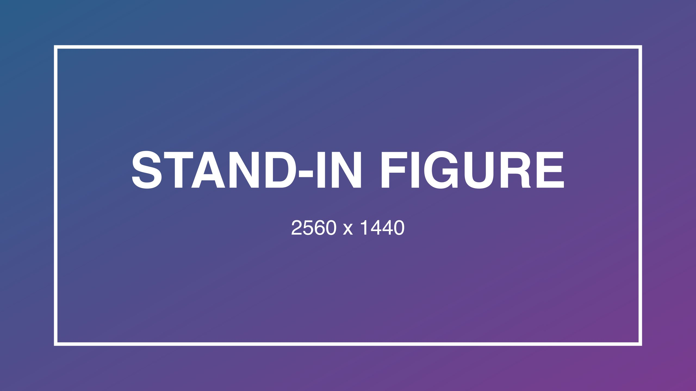
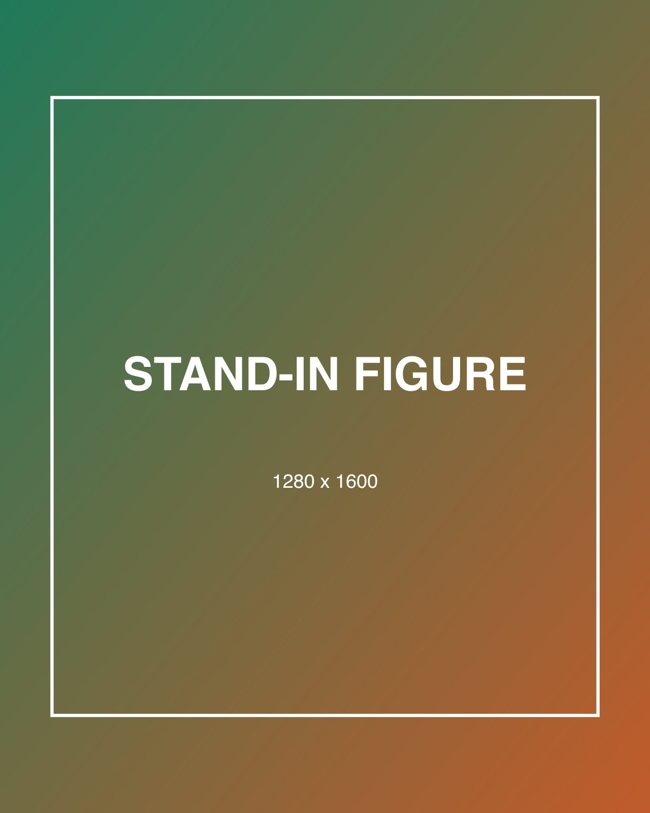

## Challenge

PLACEHOLDER: the challenge, in the owner's words.

## Approach

PLACEHOLDER: the approach, in the owner's words.

## Results

PLACEHOLDER: the results in prose, in the owner's words.
